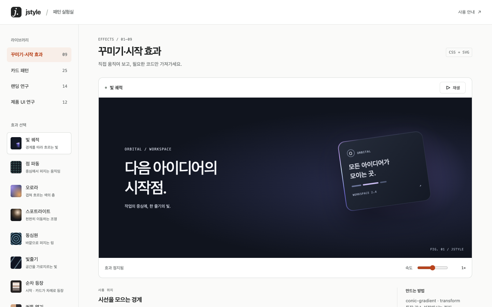

# jstyle

jstyle is a UI design skill for AI agents. It helps an agent set a design direction and check a real interface.


The library has 25 card patterns and nine visual and entry effects. Select an effect, change its speed, and copy its standalone HTML.



## Install

Install Node.js and `npx`. Run this command in your project folder:

```bash
npx skills add x-mesh/jstyle
```

Select the agents that will use the skill. To install only for Codex, run:

```bash
npx skills add x-mesh/jstyle --agent codex --skill jstyle
```

To install for all projects, add `-g`:

```bash
npx skills add x-mesh/jstyle -g
```

The repository is private. You need access and Git, GitHub CLI, or SSH authentication.
To install from a local copy, run `npx skills add .` in that folder.

### Use the command

The comparison page generator and the screenshot tool are also available as the `jstyle` command. The command needs Node 22 or later.

```bash
npm i -g github:x-mesh/jstyle
jstyle explore ./designs
```

`jstyle explore` puts the HTML drafts of a folder on one comparison page. Then it starts a local server and opens the page in the browser.
To open the page on another device in the same network, add `--host 0.0.0.0`. Then open the `Other devices` address in the terminal output.
If you do not install the command, run `node bin/jstyle.mjs explore ./designs` in the skill folder.
Run `jstyle --help` to see all commands. Run `jstyle doctor` to check the tools that the commands need.

## Get started

After installation, ask the agent to use jstyle:

```text
Use jstyle to improve the navigation and empty state of my dashboard.
```

Download this repository to open the pattern library. Run this command from its root folder. The command needs Node 22 or later.

```bash
node bin/jstyle.mjs library
```

The pattern library opens in the browser. If it does not open, open the address in the terminal output. Select an effect and press the play button. Open the code panel to copy the standalone HTML. Use search or a category filter to find a card pattern.

The examples use mock data. The page keeps edits in memory until you refresh it. The examples do not connect to authentication or server storage.

## Workflow

1. Record the user, task, content, brand, and device constraints.
2. Choose the main object and action. Set the layout and key states.
3. Build a representative screen. Check its text and actions in the browser.

The agent can compare design directions or review an existing screen without file changes. The [skill guide](SKILL.md) links to the relevant references.

## Tools

- [Comparison page generator](references/style-explorer.md): Compare design options on one page. It needs Node 22 or later.
- [Screenshot tool](references/tools.md): Capture screens and animation frames. It needs Node 22 or later and Chrome, Chromium, or Edge.
- [Image tools](references/media.md): Find and resize image assets.

The default workspace for drafts and screenshots is `.jstyle`. Put final code and assets in the target project.

## Check

Run these commands from the project root:

```bash
npm run check
npm run test:patterns
node --test tests/test_html_parser.mjs tests/test_cli.mjs
python3 -m unittest discover -s tests
```

The pattern browser test needs Node 22 or later and Chrome, Chromium, or Edge. The package name is `jstyle`. It is a private local package.

## License

The [MIT license](LICENSE) preserves the original copyright notice.
