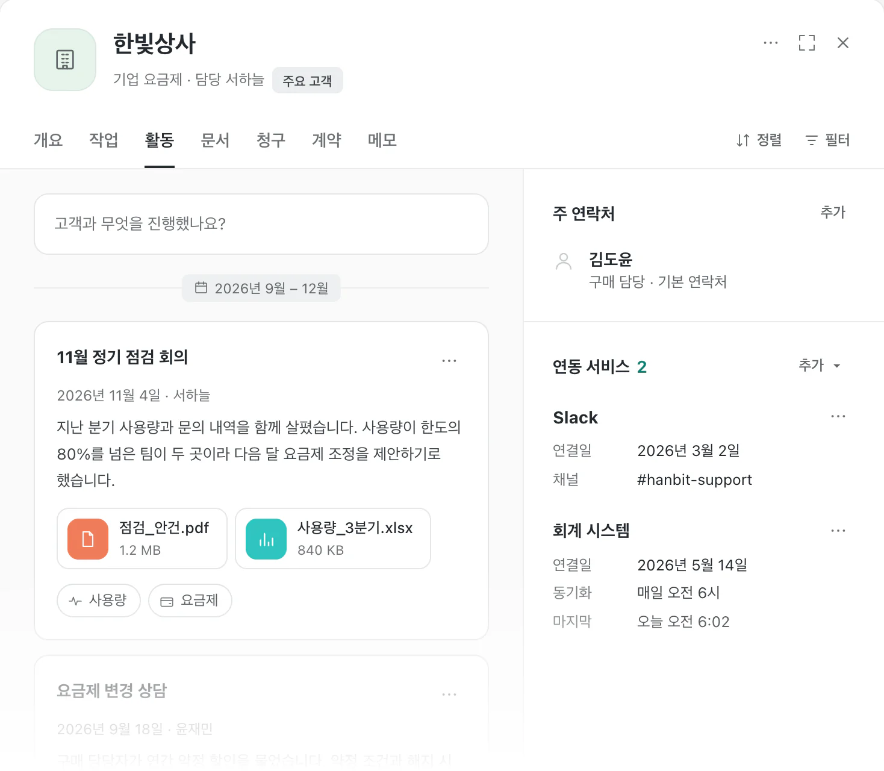
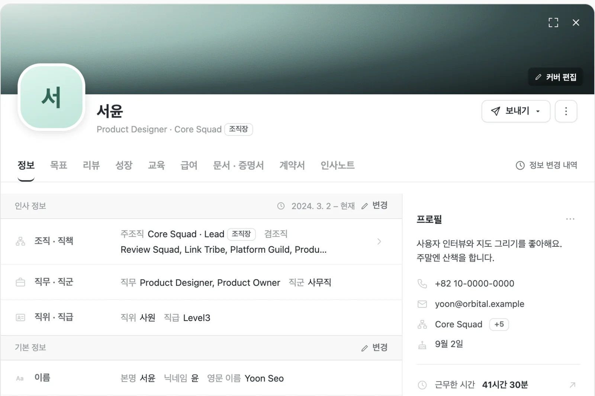
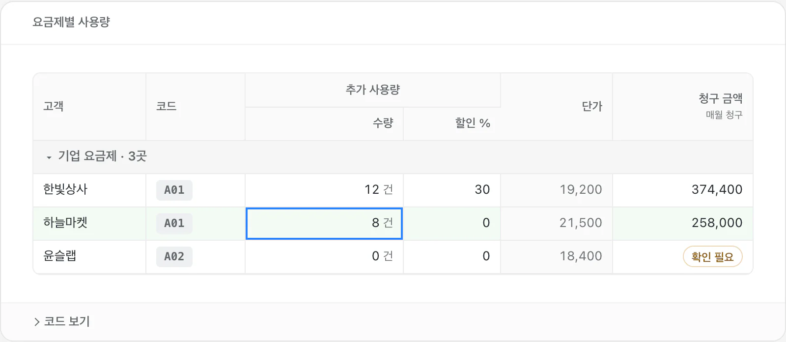
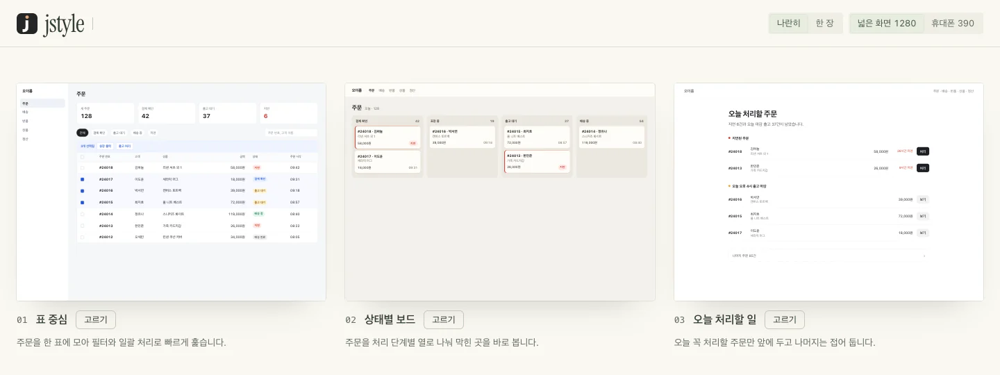

# jstyle

[English](README.md)

jstyle은 화면을 만들고 다듬는 AI 에이전트를 위한 스킬입니다. 디자인 방향을 정하고, 실제 화면을 보며 배치와 사용 흐름을 고치는 데 도움을 줍니다.


업무 화면용 컴포넌트 키트가 들어 있습니다. 목록, 표, 설정, 상세 시트처럼 정보가 많은 화면에 씁니다.



패턴 라이브러리에는 꾸미기·시작 효과 9종, 카드 패턴 25개, 랜딩 연구 14개, 제품 UI 연구 12개가 있습니다. 패턴을 직접 눌러 보고, 효과를 고른 뒤 재생 속도를 바꾸거나 HTML 코드를 복사할 수 있습니다.

## 설치

모든 프로젝트에서 쓸 스킬과 `jstyle` 명령을 한 번에 설치하려면 다음 명령을 실행합니다. Node 22 이상이 필요하고, `PATH`에 `claude`나 `codex`가 있어야 합니다.

```bash
curl -fsSL https://raw.githubusercontent.com/x-mesh/jstyle/main/install.sh | bash
```

스크립트는 찾은 에이전트마다 스킬을 설치하고, `~/.local/bin/jstyle`을 설치된 스킬에 연결합니다. 다른 폴더에 연결하려면 `JSTYLE_BIN_DIR`을 지정합니다. 내려받은 폴더에서는 `./install.sh`를 실행합니다. 다시 실행하면 최신 버전으로 업데이트합니다.

### 스킬만 설치하기

Node.js와 `npx`가 필요합니다. 현재 프로젝트에서 사용할 스킬은 해당 프로젝트 폴더에서 설치합니다.

```bash
npx skills add x-mesh/jstyle
```

설치할 에이전트를 고르면 해당 에이전트의 스킬 폴더에 `jstyle`이 추가됩니다. Codex에만 설치하려면 다음 명령을 사용합니다.

```bash
npx skills add x-mesh/jstyle --agent codex --skill jstyle
```

모든 프로젝트에서 사용하려면 `-g`를 붙입니다.

```bash
npx skills add x-mesh/jstyle -g
```

이미 내려받은 폴더에서 설치하려면 해당 폴더 안에서 `npx skills add .`을 실행합니다.

### 명령으로 쓰기

비교 화면 생성기, 캡처 도구, 이미지 도구는 `jstyle` 명령으로도 쓸 수 있습니다. 명령은 `install.sh`가 설치하고, 설치 상태는 `jstyle doctor`로 확인합니다.

`jstyle doctor`는 Node, 브라우저, 명령의 설치 위치를 확인합니다. 전체 명령은 `jstyle --help`로 봅니다. 설치하지 않았다면 스킬 폴더에서 `node bin/jstyle.mjs <명령>`으로 같은 일을 합니다.

## 먼저 써 보기

설치한 뒤 에이전트에게 다음처럼 요청합니다.

```text
jstyle을 사용해 기존 대시보드의 메뉴와 빈 화면을 다듬어 주세요.
```

에이전트는 [SKILL.md](SKILL.md)에서 작업 범위와 필요한 참고 문서를 찾습니다. 기존 화면을 살펴보기만 해 달라고 요청할 수도 있습니다.

패턴을 직접 보려면 이 저장소를 내려받은 뒤, 저장소 루트에서 다음 명령을 실행합니다. Node 22 이상이 필요합니다.

```bash
node bin/jstyle.mjs library
```

브라우저에서 패턴 라이브러리가 열립니다. 열리지 않으면 터미널에 나온 주소를 엽니다. 왼쪽에서 효과를 고르고 **재생**을 누르면 미리보기가 움직입니다. **코드 보기**에서 해당 효과의 독립 HTML을 복사할 수 있습니다. 카드 패턴은 이름과 용도로 검색할 수 있습니다.

랜딩 연구와 제품 UI 연구는 공개 페이지와 제품 화면을 대조해 다시 만든 토큰과 화면 패턴입니다. 사람과 조직 이름은 가상 데이터입니다.



목록, 표, 설정, 승인처럼 정보가 많은 업무 화면에는 컴포넌트 키트를 씁니다. 빌드 없이 `kit.css`와 `kit.js`를 붙여 쓰며, 다음 명령으로 문서를 엽니다.

```bash
node bin/jstyle.mjs kit
```



예제의 내용과 바꾼 값은 브라우저 메모리에만 있으며, 새로고침하면 처음 상태로 돌아갑니다. 예제는 인증이나 서버 저장에 연결되지 않았습니다.

## 여러 시안 비교하기

방향을 정하기 어려우면 에이전트에게 시안 여러 개를 비교 화면으로 보여 달라고 요청합니다.

```text
jstyle로 주문 관리 화면의 첫 화면 시안을 세 가지 만들어 비교 화면으로 보여 주세요.
```

에이전트는 각 방향을 먼저 글로 설명합니다. 실제 화면으로 보고 싶다고 하면 안마다 첫 화면 HTML을 하나씩 만들고 비교 화면 한 장으로 모읍니다. 개수를 정하지 않으면 세 가지를 만듭니다.

비교 화면은 안들을 회색 보드에 나란히 놓고 시작합니다. Shift+휠이나 트랙패드 핀치로 확대·축소하고, 빈 곳을 끌어 이동하며, F를 누르면 다시 한눈에 맞춥니다. 안을 누르면 그 안을 크게 보고, 아래 필름 띠로 다른 안으로 넘어갑니다. 기본 화면 크기는 데스크톱 1280×900과 모바일 390×844입니다. 마음에 드는 안에서 **고르기**를 누르면, 고른 안과 의견이 에이전트에게 바로 전달되고 에이전트가 그 안으로 작업을 이어 갑니다. 대화창으로 돌아와 붙여 넣을 필요가 없습니다.

특정 요소에 의견을 남기려면 위쪽의 **의견 달기**(단축키 C)를 켜고, 보드나 크게 보기에서 요소를 누릅니다. 요소 옆에 뜨는 칸에서 좋음이나 고침을 고르고 의견을 적습니다. 여러 안에 의견을 달 수 있으며, 오른쪽 검토 패널에서 안별 목록과 전체 의견을 확인하고 **보내기**를 누릅니다. 패널은 접을 수 있습니다. 안을 고르지 않고 의견만 보낼 수도 있고, **복사**를 누르면 에이전트 대화창에 붙여 넣을 글을 복사합니다. 파일로 직접 연 비교 화면에서도 의견을 달고 복사할 수 있습니다. 실행 중인 개발 서버 페이지와 이미지 안에는 의견을 달 수 없습니다.

파일로 직접 연 비교 화면에서는 **고르기**가 `01회: 02 이름 안을 고릅니다` 같은 문장을 복사합니다. 이 문장을 에이전트에게 붙여 넣습니다.



이미 만든 시안이 있으면 직접 비교 화면을 만들 수 있습니다.

```bash
jstyle explore ./designs
```

폴더 안의 HTML 파일이 각각 하나의 안이 되고, 이름은 HTML의 `<title>`이나 파일 이름을 씁니다. 결과는 폴더 안의 `style-explorer.html`이며, 터미널에서 실행하면 로컬 서버로 띄워 브라우저에서 엽니다. 시안을 고친 뒤 다시 만들려면 `--force`를 붙입니다.

띄운 비교 화면에서 고른 안은 의견과 함께 폴더의 `choice.json`에 저장됩니다. `--wait`를 붙이면 처음 고를 때까지 기다렸다가 고른 안을 JSON 한 줄로 출력하고 끝납니다. 에이전트는 이 방식으로 선택을 받습니다.

- 휴대폰이나 다른 컴퓨터에서 보기: `--host 0.0.0.0`을 붙이고 터미널에 나온 `Other devices` 주소를 엽니다. 같은 네트워크의 다른 사람도 이 주소를 열 수 있습니다.
- 지금 화면과 함께 보기: `manifest.json`에서 기존 화면을 `"baseline": true`로 넣으면 첫 항목에 놓입니다. 실행 중인 개발 서버의 페이지는 `"kind": "url"`로 넣을 수 있지만 다른 기기에서는 보이지 않습니다.
- 다음 회차: 고른 안을 다듬어 다시 비교할 때는 `explore/02/`처럼 회차 폴더를 새로 만들고 `round`를 `"02"`로 올립니다. 지난 회차는 그대로 남깁니다.

manifest 필드는 [비교 화면 문서](references/style-explorer.md)와 `jstyle explore --help-build`에 있습니다.

## 작업 방식

1. 사용자와 작업, 실제 내용, 지켜야 할 브랜드와 기기 조건을 정리합니다.
2. 화면의 중심 대상과 주된 동작을 정하고 배치와 주요 상태를 잡습니다.
3. 대표 화면과 작업 흐름을 만든 뒤 실제 화면에서 읽기 쉬움과 동작을 확인합니다.

사용자가 디자인 방향을 비교해 달라고 하면 [여러 시안을 한 화면에 모아](#여러-시안-비교하기) 고르게 합니다. 기존 화면을 바꾸지 않고 살펴보는 작업에도 쓸 수 있습니다. 자세한 경로는 [참고 문서 목록](SKILL.md#작업에-맞는-문서)에서 고릅니다.

## 함께 들어 있는 도구

- [비교 화면 생성기](references/style-explorer.md): 여러 디자인 안을 한 페이지에 모아 비교합니다. Node 22 이상이 필요합니다.
- [캡처 도구](references/tools.md): 화면 크기별 스크린샷과 움직임의 연속 프레임을 만듭니다. Node 22 이상과 Chrome, Chromium 또는 Edge가 필요합니다.
- [이미지 도구](references/media.md): 이미지 자료를 찾고 크기를 바꾸는 방법을 안내합니다.
- [사이트 평가](references/eval/site-eval.md): `jstyle eval`이 공개된 사이트를 보기만 하며 첫 화면·배치·axe-core·성능 근거를 남기고, 판정 하나와 고칠 목록으로 이어집니다. Node 22 이상과 Chrome, Chromium 또는 Edge가 필요합니다.

작업 중 만든 캡처와 시안은 기본적으로 `.jstyle`에 둡니다. 최종 코드와 이미지는 작업 중인 프로젝트의 정식 위치에 둡니다.

## 확인

프로젝트 루트에서 다음 명령을 실행합니다.

```bash
npm run check
node --test "tests/test_*.mjs"
```

패턴의 브라우저 검사에는 Node 22 이상과 Chrome, Chromium 또는 Edge가 필요합니다. `package.json`의 이름은 `jstyle`이며, npm 레지스트리에는 올리지 않고 GitHub에서 바로 설치합니다.

## 라이선스

[MIT 라이선스](LICENSE)의 원본 저작권 고지를 유지합니다. 가져와 고친 자료는 [NOTICE.md](NOTICE.md)에 적었습니다.
