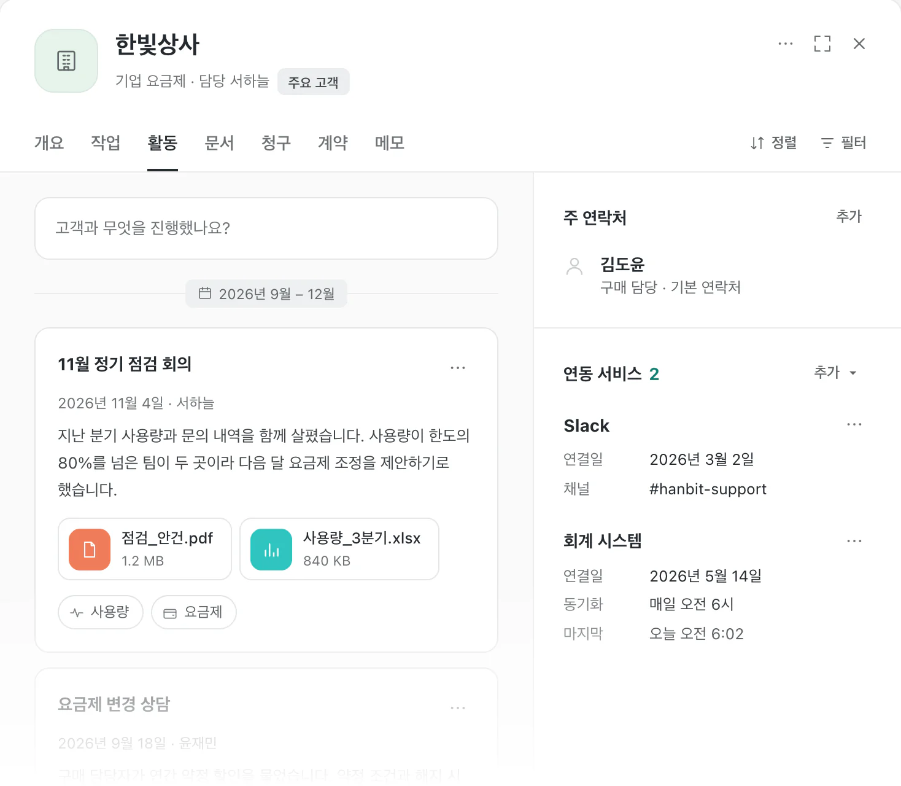
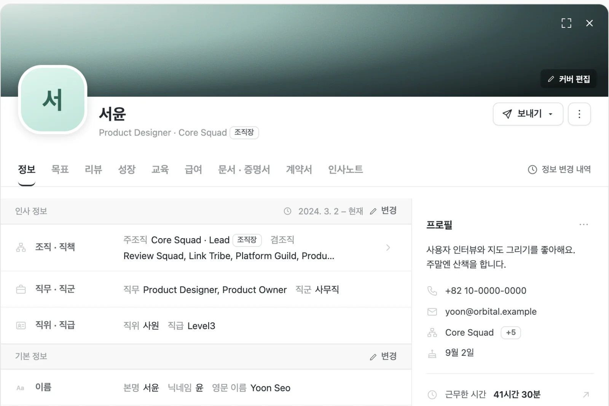
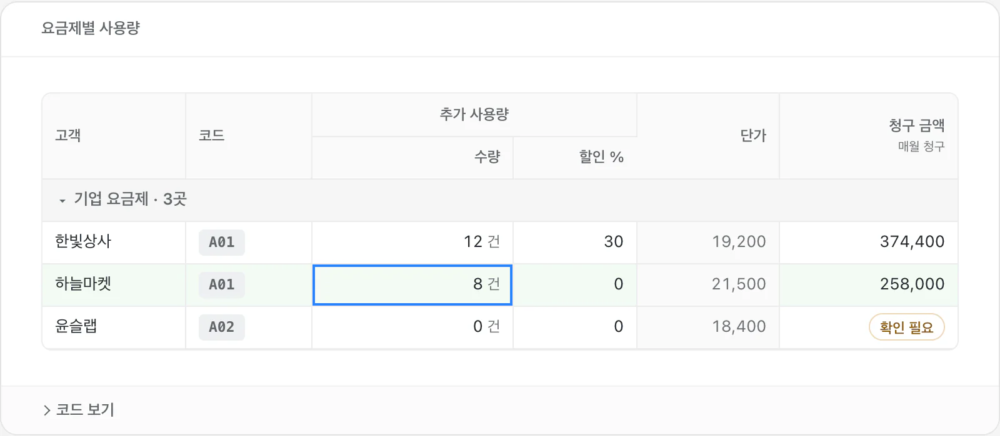
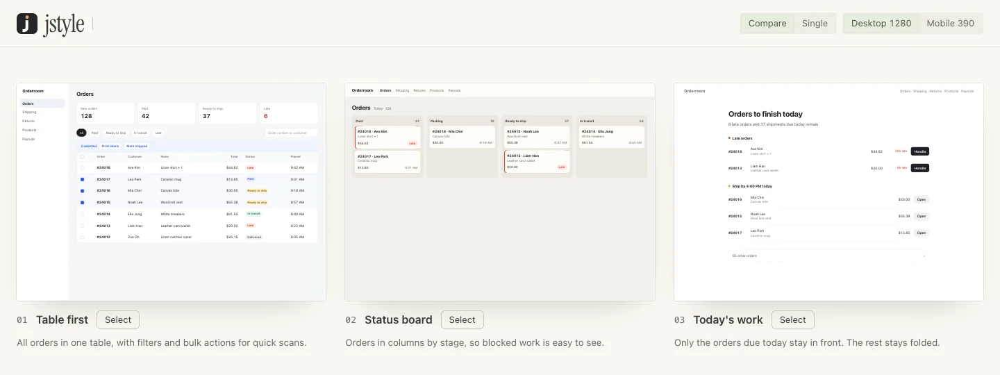

# jstyle

[한국어](README.ko.md)

jstyle is a UI design skill for AI agents. It helps an agent set a design direction and check a real interface.


jstyle includes a component kit for business screens. Use it for dense screens, such as lists, tables, settings, and detail sheets.



The pattern library has nine visual and entry effects, 25 card patterns, 14 landing studies, and 12 product UI studies. Select an effect, change its speed, and copy its standalone HTML.

## Install

To install the skill and the `jstyle` command for all projects, run this command. It needs Node 22 or later and `claude` or `codex` on `PATH`.

```bash
curl -fsSL https://raw.githubusercontent.com/x-mesh/jstyle/main/install.sh | bash
```

The script installs the skill for each agent it finds and links `~/.local/bin/jstyle` to the installed skill. To use a different folder, set `JSTYLE_BIN_DIR`. In a local copy, run `./install.sh`. Run the script again to update.

### Install only the skill

Install Node.js and `npx`. Run this command in your project folder:

```bash
npx skills add x-mesh/jstyle
```

Select the agents that will use the skill. To install only for Codex, run:

```bash
npx skills add x-mesh/jstyle --agent codex --skill jstyle
```

To install for all projects, add `-g`:

```bash
npx skills add x-mesh/jstyle -g
```

To install from a local copy, run `npx skills add .` in that folder.

### Use the command

The comparison page generator, the screenshot tool, and the image tools are also available as the `jstyle` command. `install.sh` installs the command. Run `jstyle doctor` to check the installation.

`jstyle doctor` checks Node, the browser, and the location of the command. Run `jstyle --help` to see all commands.
If you do not install the command, run `node bin/jstyle.mjs <command>` in the skill folder.

## Get started

After installation, ask the agent to use jstyle:

```text
Use jstyle to improve the navigation and empty state of my dashboard.
```

Download this repository to open the pattern library. Run this command from its root folder. The command needs Node 22 or later.

```bash
node bin/jstyle.mjs library
```

The pattern library opens in the browser. If it does not open, open the address in the terminal output. Select an effect and press the play button. Open the code panel to copy the standalone HTML. Use search or a category filter to find a card pattern.

The landing and product UI studies rebuild tokens and screen patterns from public pages and product screens. All person and team names are mock data. The library pages are in Korean.



Use the component kit for dense business screens, such as lists, tables, settings, and approvals. Add `kit.css` and `kit.js` to a page. No build step is necessary. To open the kit documentation, run:

```bash
node bin/jstyle.mjs kit
```



The examples use mock data. The page keeps edits in memory until you refresh it. The examples do not connect to authentication or server storage.

## Compare design drafts

If you cannot choose a direction, ask the agent for several drafts on one comparison page:

```text
Use jstyle to make three drafts of the first screen of the order dashboard. Show them on a comparison page.
```

The agent first describes each direction in text. If you want to see the screens, it makes one HTML first screen for each draft and puts them on one comparison page. If you do not give a number, it makes three drafts.

The comparison page starts with the drafts side by side on a gray board. To zoom, use Shift+wheel or a trackpad pinch. To move, drag empty space. To fit all drafts again, press F. Click a draft to open it large, and use the strip at the bottom to move to another draft. The default screen sizes are 1280×900 for desktop and 390×844 for mobile.
Press **Select** on the draft that you prefer. The page sends the draft and your notes to the agent, and the agent continues with the selected draft. You do not paste anything into the chat.

To comment on one element, turn on **Comment** at the top (shortcut C), then click the element on the board or in an open draft. In the box next to the element, choose Keep or Change and write your note. You can comment on more than one draft. The review panel on the right lists the comments by draft and holds the overall notes. Press **Send** there. You can hide the panel. You can send comments without selecting a draft. To paste the result into the agent chat, press **Copy**. This also works in a page that you open as a file. You cannot comment inside a page from a running development server or inside an image.

If you open the page as a file, **Select** copies a sentence such as `Round 01: Go with 02 Name`. Paste this sentence to the agent.



If you already have drafts, make the comparison page yourself:

```bash
jstyle explore ./designs
```

Each HTML file in the folder becomes one draft. The name comes from the HTML `<title>` or from the file name. The result is `style-explorer.html` in the folder. If you run the command in a terminal, it starts a local server and opens the page in the browser. To make the page again after you change a draft, add `--force`.

When you serve the page, the page writes the selected draft and the notes to `choice.json` in the folder. With `--wait`, the command waits for the first selection, prints it as one JSON line, and stops. The agent uses this to get your selection.

- Open the page on a phone or another computer: add `--host 0.0.0.0`, then open the `Other devices` address in the terminal output. Other people in the same network can also open this address.
- Compare with the current screen: in `manifest.json`, add the current screen with `"baseline": true`. It becomes the first item. A page from a running development server can use `"kind": "url"`, but other devices cannot show it.
- Start the next round: to compare refined drafts, make a new round folder such as `explore/02/` and set `round` to `"02"`. Keep the previous round as it is.
- Manage running servers: run `jstyle ps` to see the servers and their addresses again, and `jstyle stop <port|project|all>` to end them. A comparison page or hub server closes on its own after 30 minutes with no open page and no request.
- Work on several pages: run `jstyle hub` to serve every comparison page under `.jstyle` from one server. The first page lists the rounds and their status for each page, and the page menu at the top of a comparison page moves to another page. Run `jstyle hub` in another project and that project joins the running hub; the hub address then lists the projects. If a hub runs on the port, a `--wait` run waits on that hub, and a pick made in a hub tab goes to it. A run that waits on one comparison page gets the picks of that page. A run of `jstyle hub --wait` gets a pick from any page of its project when no run waits on that page.
- Use one address for all projects: on the default address (127.0.0.1:8765), `hub`, `explore --serve`, `serve`, `kit` and `library` start `jstyle daemon` in the background if it is not running, add the project to it, and end. `--wait` waits on the daemon. The daemon stops after 30 minutes with no waiting agent, no open page and no request, and the next run starts it again. Its output goes to `~/.jstyle/daemon/daemon.log`. To serve from the command itself, set `JSTYLE_NO_DAEMON=1`, or give another `--port` or a non-loopback `--host`. `jstyle ps` lists the projects of the daemon and the agents that wait on each. `jstyle daemon stop` ends the daemon. If an agent waits on it, add `--force`.

The manifest fields are in the [comparison page reference](references/style-explorer.md) and in `jstyle explore --help-build`.

## Workflow

1. Record the user, task, content, brand, and device constraints.
2. Choose the main object and action. Set the layout and key states.
3. Build a representative screen. Check its text and actions in the browser.

The agent can [compare design directions on one page](#compare-design-drafts) or review an existing screen without file changes. The [skill guide](SKILL.md) links to the relevant references.

## Tools

- [Comparison page generator](references/style-explorer.md): Compare design options on one page. It needs Node 22 or later.
- [Screenshot tool](references/tools.md): Capture screens and animation frames. It needs Node 22 or later and Chrome, Chromium, or Edge.
- [Image tools](references/media.md): Find and resize image assets.
- [Site evaluation](references/eval/site-eval.md): `jstyle eval` opens a live site read-only and records folds, layout, axe-core and Core Web Vitals evidence for a verdict and a ranked fix list. It needs Node 22 or later and Chrome, Chromium, or Edge.

The default workspace for drafts and screenshots is `.jstyle`. Put final code and assets in the target project.

## Check

Run these commands from the project root:

```bash
npm run check
node --test "tests/test_*.mjs"
```

The pattern browser test needs Node 22 or later and Chrome, Chromium, or Edge. The package name is `jstyle`. The package is not on the npm registry. Install it from GitHub.

## License

The [MIT license](LICENSE) preserves the original copyright notice. Adapted third-party material is listed in [NOTICE.md](NOTICE.md).
